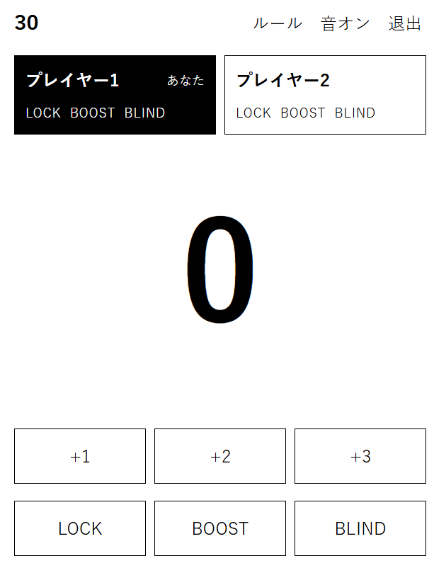

# 30

2人で遊ぶ、数字を進める対戦ゲームです。0から交互に数を足していき、30以上にした人が負けます。運の要素はなく、各プレイヤーが1回ずつ持つ3つの能力で、相手の手を崩します。

同じ端末で交代するローカル対戦と、4文字のコードで部屋を立てるオンライン対戦があります。



## 遊び方

```
git clone https://github.com/yu3559/30-Game.git
cd 30-Game
npm install
npm run dev
```

表示された `http://localhost:5173/` を開きます。

- ローカルでは、1台の端末を交代で使います。手番が来たら「準備できた」を押してから数字を選びます。
- オンラインでは、ホストがルームを作り、表示されたコードを相手に伝えます。相手は同じページでそのコードを入れて参加します。

手番では +1、+2、+3 のいずれかを押します。LOCK か BLIND を使うときは、先にそのボタンを押してから数字を押します。BOOST は押した瞬間、手を +4 にします。

## ルール

0から始め、交互に +1、+2、+3 のどれかで進めます。30以上にした人が負けです。

2人とも LOCK、BOOST、BLIND を1回ずつ持っています。1ターンに使えるのは1つまでで、使ったかどうかは相手にも分かります。

- **LOCK** 数字を進めるときに一緒に使います。相手の次の手は +1 だけになります。
- **BOOST** 自分の手を +4 にします。+1〜+3 の代わりに使います。
- **BLIND** 数字を進めるときに一緒に使います。相手の次の1ターンだけ、今の数字が隠されます。隠しているあいだ、ローカルの交代画面にも、相手の端末にも数字は出ません。

再戦するたびに先手が交代します。オンラインでは、ルームを作った人が最初の先手です。
