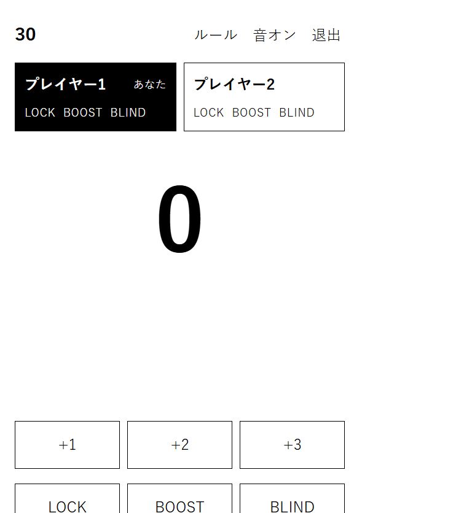

# 30

2人で遊ぶ、数字を進める対戦ゲームです。0から交互に数を足していき、30以上にした人が負けます。運の要素はなく、各プレイヤーが1回ずつ持つ3つの能力で、相手の手を崩します。

対戦の正はサーバーが持ち、ブラウザは受け取った局面を表示するだけです。BLIND中は、相手の端末へ新しい数字を送りません。勝敗と能力の規則は `shared/rules.js` にまとめ、クライアントとサーバーの両方から使い、`npm test` で確認しています。

同じ端末で交代するローカル対戦と、4文字のコードでつなぐオンライン対戦があります。画面は白と黒だけです。対局中に見るものは、今の数字と、残っている能力と、次の手だけです。



## 工夫した点

- **サーバーが局面の正である。** オンラインの手はサーバーで判定し、不正な手は拒否します。ブラウザは送られた局面を描くだけです。
- **BLINDは表示だけでなく通信でも隠す。** 能力の選択が終わるまで、相手には手番前の数字だけを送ります。隠しているあいだのメッセージに、新しい数字は含まれません。使った本人の画面には数字が残ります。
- **規則は1か所。** `shared/rules.js` をブラウザとサーバーで共有しています。ローカル対戦もオンライン対戦も同じ判定です。

`npm test` は、規則そのものと、オンライン通信を確かめています。オンラインのテストでは、BLIND中の通信に数字が漏れないことと、LOCK中の +3 がサーバーに拒否されることを見ています。

## 遊び方

```
npm install
npm run dev
```

表示された `http://localhost:5173/` を開きます。

- ローカルでは、1台の端末を交代で使います。手番が来たら「準備できた」を押してから数字を選びます。
- オンラインでは、ホストがルームを作り、表示されたコードを相手に伝えます。相手は同じページでそのコードを入れて参加します。

手番では +1、+2、+3 のいずれかを押します。LOCK か BLIND を使うときは、先にそのボタンを押してから数字を押します。BOOST は押した瞬間に +4 します。

## ルール

0から始め、交互に +1、+2、+3 のどれかで進めます。30以上にした人が負けです。

2人とも LOCK、BOOST、BLIND を1回ずつ持っています。1ターンに使えるのは1つまでで、使ったかどうかは相手にも分かります。

- **LOCK** 数字を進めるときに一緒に使います。相手の次の手は +1 だけになります。
- **BOOST** 自分の手を +4 にします。+1〜+3 の代わりに使います。
- **BLIND** 数字を進めるときに一緒に使います。相手の次の1ターンだけ、今の数字が隠されます。隠しているあいだ、ローカルの交代画面にも、相手の端末にも数字は出ません。

再戦するたびに先手が交代します。オンラインでは、ルームを作った人が最初の先手です。
